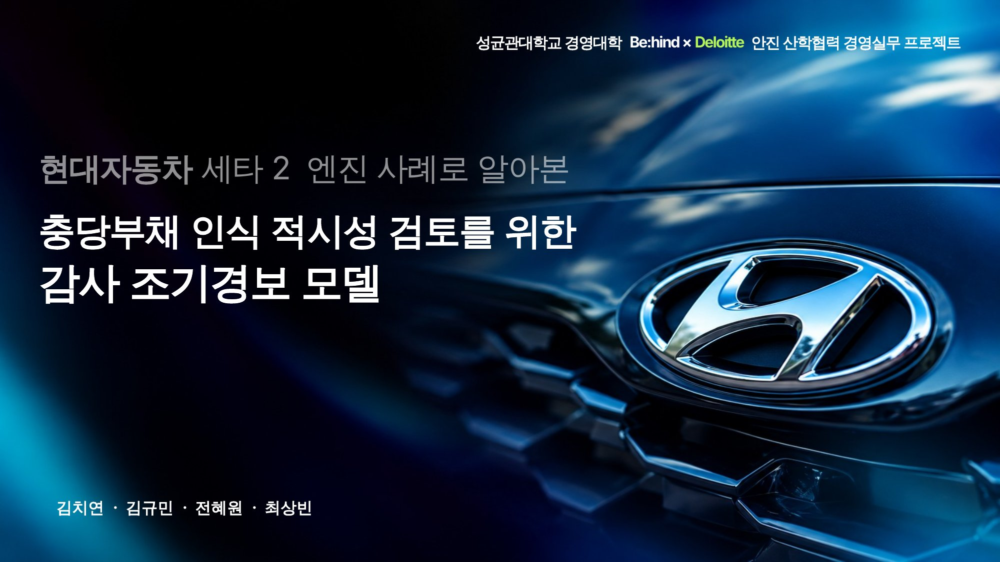
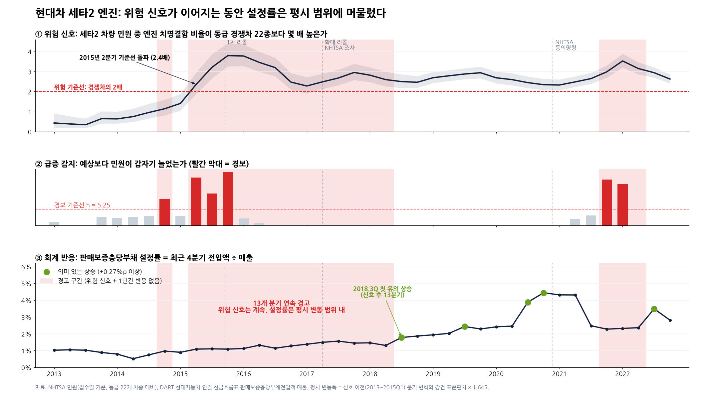
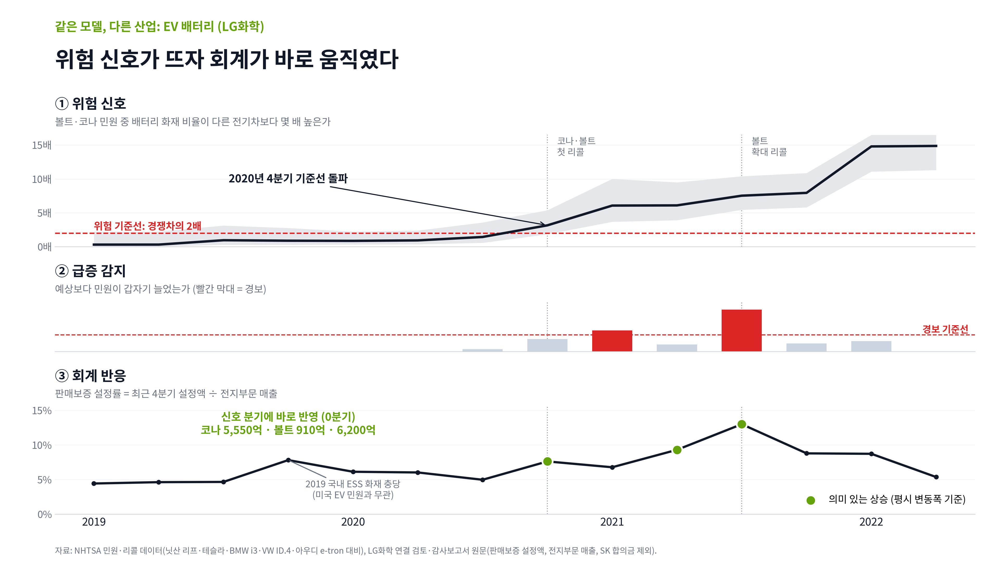

# 세타2 엔진 판매보증충당부채 감사 조기경보(EWS) 모델

> 성균관대학교 경영대학 × 딜로이트 안진 산학협력 경영실무 프로젝트 (2026)
> **현대자동차 세타2 엔진 사례로 알아본, 충당부채 인식 적시성 검토를 위한 감사 조기경보 모델**



## 한 줄 요약

미국 NHTSA 공개 민원(대체데이터)과 DART 공시 판매보증충당부채 설정률을 결합해 **"회사 밖 결함 신호는 켜져 있는데 충당부채 설정률은 평소 이상으로 움직이지 않은 분기"** 를 골라내는 감사용 선별 도구입니다.
금액을 추정하거나 회사 회계처리의 옳고 그름을 판정하지 않고, 감사인이 **핵심 가정(엔진 교환율)을 기말에 다시 검토할 근거가 있었는지**(K-IFRS 1037호 문단 59, ISA 540) 우선순위를 주는 데 목적이 있습니다.

## 문제 정의

- 현대차는 2015년 1차 리콜(15V-568) 이후 2017년 확대 리콜, 2020년 NHTSA 동의명령을 거치며 세타2 관련 판매보증충당부채를 크게 늘렸습니다(2020년 조정 사유: 엔진 교환율 상승, 운행기간 12.6→19.5년 재산정).
- 회사가 쓰는 경험률 방식은 업계 표준이지만, 실제 교환 실적이 누적된 뒤에 따라오는 **시차**가 구조적으로 존재합니다.
- 질문: **2020년 조정의 핵심 가정 변화를 외부 민원으로 앞서 감지해, 기말 재검토를 시작할 근거가 있었는가?**

## 모델 구조 (DPA-EWS, 3-KEY)

```
입력                    질문                                   출력
NHTSA 민원  ──►  ① 위험 신호: 경쟁차보다 치명 엔진결함 비중이 높은가 ─┐
                 ② 급증 감지: 자기 과거 대비 갑자기 늘었는가        ─┼─►  재검토 대상 분기
DART 설정률 ──►  ③ 회계 반응: 설정률이 평소 이상으로 올랐는가      ─┘
```

| 단계 | 방법 | 판정 기준 | 감사 관점 |
|---|---|---|---|
| ① 위험 신호 | **PRR**(비례보고비, 약물감시 불균형 분석) 최근 4분기 누적. 세타2 차량 민원 중 치명 엔진결함 비중 ÷ 동급 경쟁차 22종의 같은 비중 | PRR ≥ 2 & 95% 신뢰구간 하한 > 1 (Evans 기준) | 위험평가(ISA 315/540) 단계의 외부 정보 |
| ② 급증 감지 | **Poisson CUSUM**: 예상 건수 초과분을 누적 | 누적값 > h. h는 결함 이슈 없는 대조군 플라시보 오경보율 5%로 보정(h = 5.25) | 새 위험 발생 시점 포착 |
| ③ 회계 반응 | **TTM 설정률** = 최근 4분기 판매보증 설정액 ÷ 최근 4분기 매출 | 분기 상승폭 > 평시 변동폭 × 1.645 (약 +0.30%p, 강건 σ = 1.4826×MAD) | 실증적 분석적절차(ISA 520)의 기대치·허용차이 구조 |

**경고 규칙**: 위험 신호가 켜져 있는데 그 분기를 포함한 최근 4분기 동안 ③ 회계 반응이 한 번도 없으면 경고(재검토 대상 분기).

설계 원칙
- **Point-in-time**: 분기 t 판정에는 t분기 말까지 접수(LDATE)된 민원만 사용해 사후정보를 차단
- **동일 잣대**: 대상군·대조군에 같은 분류기 적용 → 판매량·신고 성향·리콜 보도 효과 상쇄
- **임계값 사전 보정**: 결과를 보고 맞추지 않고 대조군 플라시보로 고정

비교군 22종: MY2011~2019 동급 중형 세단·SUV (Toyota Camry/RAV4/Highlander, Honda Accord/CR-V/Pilot, Nissan Altima/Rogue/Murano, Ford Fusion/Escape/Edge, Chevrolet Malibu/Equinox, Mazda 6/CX-5, Subaru Legacy/Outback/Forester, VW Passat/Tiguan, GMC Terrain). 부품 필터 ENGINE, 기간 2010Q1~2022Q4.

## 결과



- **위험 신호**: 2015Q2 경쟁차 대비 약 2.4배로 기준선 돌파(1차 리콜보다 1분기 앞섬), 이후 2022년까지 2배 아래로 내려간 분기 없음
- **급증 감지**: 첫 경보 2014Q4(1차 리콜 3분기 전), 2021Q4·2022Q1 새 급증
- **회계 반응**: 첫 유의 상승은 2018Q3로 **신호 후 13분기**. 그 사이 설정률은 1.1%대에서 1.5%대로 완만히 올랐지만 어느 분기도 평시 변동폭을 넘지 않음
- **경고 구간**: 2016Q2~2018Q2 **9개 분기 연속** (위험 신호는 계속, 설정률은 제자리)
- **사후 확인**: 2021Q4 경고 재발 → 3분기 뒤 2022Q3 1.36조 원 추가 충당

| 연도 | 2015 | 2016 | 2017 | 2018 | 2019 | 2020 |
|---|---|---|---|---|---|---|
| 판매보증 설정률(주석 전입액 ÷ 매출) | 1.09% | 1.28% | 1.44% | 1.76% | 2.34% | 4.97% |

### 대조 사례: LG화학 EV 배터리 (볼트EV·코나EV)



같은 모델을 그대로 적용하면 위험 신호와 설정률 유의 상승이 **같은 분기(2020Q4, 코나 리콜 관련 충당)** 에 나타나 경고가 켜지지 않습니다. 모델이 "신호만 있으면 무조건 경고"하지 않는다는 근거입니다. (2019Q4 설정률 상승은 국내 ESS 화재 관련으로 NHTSA 신호와 무관)

### 타당성 점검
1. **선행성**: 1차 리콜 대상이 아닌 세타2 차량만 따로 봐도 확대 리콜(2017.04)보다 약 6분기 앞서 신호 발생
2. **민감도**: 회계 반응을 누적(CUSUM) 방식으로 바꾼 9개 조합 중 8개에서 첫 반응까지 13분기 이상 유지. 가장 민감한 가정은 반응 임계값
3. **범용성**: 설정만 교체해 EV 배터리 화재(LG화학)에 동일 알고리즘 적용

## 한계
- 민원은 **미국 시장** 자료, 설정률은 **연결 전체** 기준이라 세타2 몫만 분리할 수 없음
- 사후 분석이며 검증 사례가 적어 통계적 일반화를 주장하지 않음
- 대상 엔진·차종을 리콜 공고로 정해 사후 지식 편향 가능. 실무에서는 전 차종 × 부품 조합에 돌리는 것이 전제
- 민원은 결함 존재의 신호이자 교환율을 **가늠하는** 대용지표일 뿐, 교환율·운행기간 가정을 정할 정보는 아님 → 출력은 오류 판단이 아니라 "추가 확인할 분기"

## 저장소 구성

```
src/
  ews_core.py                  # 알고리즘 본체 (PRR, Poisson CUSUM, TTM 설정률, 등급 결합, h 보정) - 산업 무관 재사용 모듈
  run_theta2.py                # 세타2 설정 (대상군·대조군 22종·결함 분류 키워드) → panel.pkl
  calibrate_h.py               # 대조군 플라시보로 CUSUM 임계값 h 보정 → calib.pkl
  validate_3cases.py           # 현대 세타2 · 기아 세타2(백업) · LG화학 EV 배터리 동일 적용
  sensitivity_acc_cusum.py     # 회계 반응 누적 CUSUM 민감도 (k × h 9개 조합)
  config_battery_template.py   # EV 배터리 이식용 설정
  extract_nhtsa.py             # NHTSA 원본에서 대상군·대조군 행만 추출
scripts/
  opendart_fetch.py            # OpenDART 정기보고서 원문 → 판매보증충당부채 변동표·매출 수집
  opendart_kia_cf.py           # 기아 현금흐름표 전입액 수집
  hyundai_dart_check.py        # 현대 분기 설정액: 주석 변동표 vs 현금흐름표 대사
  kia_dart_provision.py        # 기아 분기 설정액 정리
  redraw_complaints.py         # 민원 추이 차트 재작성
data/
  nhtsa/                       # NHTSA 민원 추출본 hk.tsv.gz(현대·기아·제네시스), peer.tsv.gz(대조군), CMPL.txt(필드 정의), 월별 민원
  dart/                        # 분기별 판매보증 설정액·매출 정리 엑셀, LG화학 주석 전입액, OpenDART 원문(zip)·추출 json
results/                       # 3사 판정 결과 엑셀, h 보정·판정 결과 pkl
docs/
  images/                      # 결과 그래프
  slides/                      # 최종 발표 슬라이드 (S01~S19)
```

## 실행 방법

```bash
pip install -r requirements.txt
cd src
python run_theta2.py        # data/nhtsa → panel.pkl (대상군·대조군 분기 집계)
python calibrate_h.py       # 대조군 플라시보로 h 보정 → calib.pkl (h = 5.25)
python validate_3cases.py   # 현대·기아·LG화학 판정 → results/범용성_3사_DPA_결과.xlsx
python sensitivity_acc_cusum.py
```

데이터는 모두 공개 자료입니다. NHTSA 원본(약 1GB)은 GitHub 용량 제한으로 대상군·대조군 행만 추출한 `data/nhtsa/*.tsv.gz`를 올렸고, 원본에서 다시 만들려면 [NHTSA 데이터셋](https://www.nhtsa.gov/nhtsa-datasets-and-apis)에서 민원 파일을 받아 `python extract_nhtsa.py FLAT_CMPL.txt`를 실행하면 됩니다. DART 원문을 새로 받으려면 OpenDART API 키를 환경변수로 넘깁니다(`OPENDART_KEY=발급키 python scripts/opendart_fetch.py <corp_code> <시작일> <종료일> <tag>`).

## 팀

| 이름 | 역할 |
|---|---|
| **김치연** | 모델링, 아이디어 제시, 발표 |
| 전혜원 | PPT |
| 김규민 | 자료조사 |
| 최상빈 | 자료조사 |

## 참고 기준
K-IFRS 1037호(충당부채), K-IFRS 1008호(회계추정치 변경과 오류), ISA 540(회계추정치 감사), ISA 520(분석적절차), Evans et al.(2001) PRR 신호 기준, Lucas(1985) Poisson CUSUM
