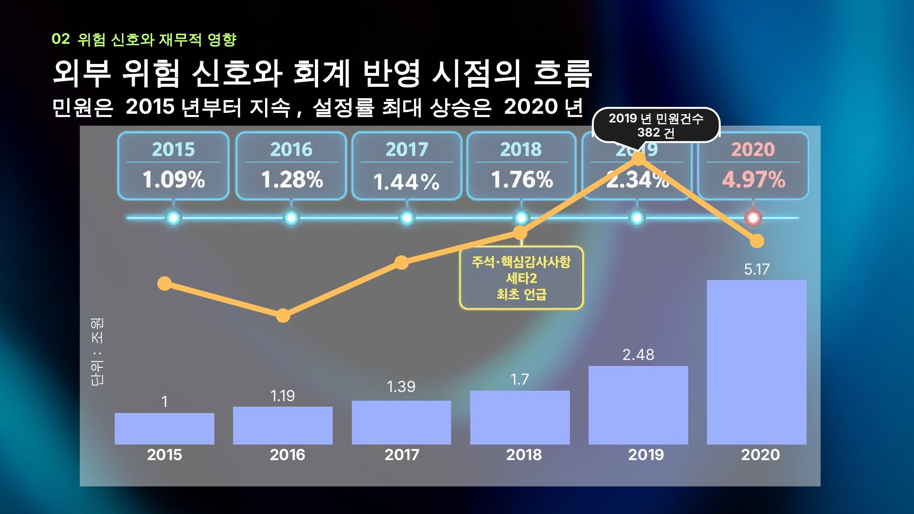
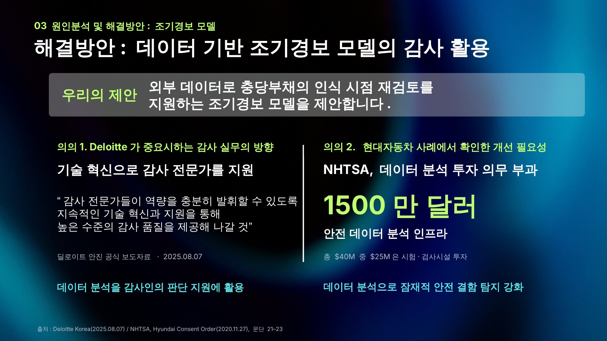
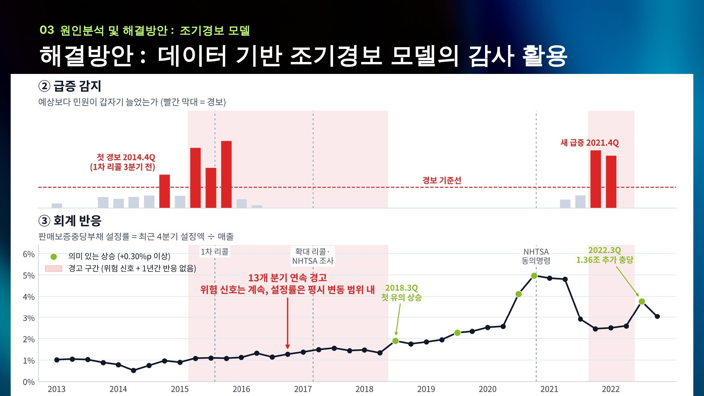

# 세타2 엔진 판매보증충당부채 감사 조기경보(EWS) 모델

> 성균관대학교 경영대학 × 딜로이트 안진 산학협력 경영실무 프로젝트 (2026)
> **현대자동차 세타2 엔진 사례로 알아본, 충당부채 인식 적시성 검토를 위한 감사 조기경보 모델**


## 프로젝트 요약

이 프로젝트는 미국 NHTSA에 접수된 공개 결함 민원을 대체데이터로 활용하고, 이를 DART에 공시된 판매보증충당부채 설정률과 함께 살펴봄으로써 **회사 밖에서는 결함 신호가 이어지고 있는데 충당부채 설정률은 평소 범위를 벗어나지 않은 분기**를 찾아내는 감사용 선별 도구입니다.

모델은 충당부채 금액을 추정하거나 회사 회계처리의 적정성을 판단하지 않습니다. 대신 감사인이 기말에 핵심 가정인 엔진 교환율을 다시 들여다볼 근거가 있었는지(K-IFRS 1037호 문단 59, ISA 540)를 분기 단위로 보여 주어, 추가 감사절차를 어느 시점에 집중할지 우선순위를 정하는 데 도움을 주는 것을 목표로 합니다.

## 핵심 결과

- 세타2 차량의 치명적 엔진 결함 민원 비중은 **2015년 2분기**에 동급 경쟁차의 2배를 넘어섰고, 이는 1차 리콜(2015년 9월)보다 한 분기 앞선 시점이었습니다.
- 반면 판매보증충당부채 설정률이 평시 변동폭을 넘어 의미 있게 오른 것은 **2018년 3분기**로, 위험 신호가 켜진 뒤 **13분기**가 지나서였습니다.
- 그 사이 **13개 분기(2015Q2~2018Q2)**는 위험 신호가 이어지는데도 설정률이 평시 범위에 머문 재검토 대상 분기로 분류되었으며, 같은 모델을 LG화학 EV 배터리 사례에 적용했을 때는 신호와 회계 반응이 같은 분기에 나타나 경고가 켜지지 않았습니다.

## 문제 정의

현대차는 2015년 1차 리콜(15V-568) 이후 2017년 확대 리콜과 2020년 NHTSA 동의명령을 거치면서 세타2 엔진 관련 판매보증충당부채를 크게 늘렸고, 2020년 조정 당시에는 엔진 교환율 상승과 함께 운행기간 가정을 12.6년에서 19.5년으로 다시 산정한 것을 사유로 밝혔습니다.

회사가 사용하는 경험률 방식은 업계에서 널리 쓰이는 표준적인 방법이지만, 실제 교환 실적이 쌓인 뒤에야 추정치에 반영되기 때문에 구조적으로 시차가 생길 수밖에 없습니다. 따라서 이 프로젝트는 회사의 산식이 틀렸는지를 묻기보다, **2020년 조정의 핵심 가정 변화를 외부 민원을 통해 미리 감지하여 기말 재검토를 시작할 근거가 있었는지**를 살펴보는 데 초점을 맞췄습니다.

## 모델 구조 (DPA-EWS)

모델은 민원 데이터로 두 가지, 공시 데이터로 한 가지를 확인한 뒤 그 결과를 결합하여 재검토 대상 분기를 고릅니다.

```
입력                    질문                                          출력
NHTSA 민원  ──►  ① 위험 신호: 경쟁차보다 치명적 엔진 결함 비중이 높은가 ─┐
                 ② 급증 감지: 자기 과거 수준보다 갑자기 늘었는가        ─┼─►  재검토 대상 분기
DART 설정률 ──►  ③ 회계 반응: 설정률이 평소보다 의미 있게 올랐는가      ─┘
```

| 단계 | 방법 | 판정 기준 | 감사 관점 |
|---|---|---|---|
| ① 위험 신호 | **PRR**(비례보고비, 약물감시에서 쓰는 불균형 분석)을 최근 4분기 누적으로 계산. 세타2 차량 민원 중 치명적 엔진 결함의 비중을 동급 경쟁차 22종의 같은 비중으로 나눔 | PRR 2배 이상이면서 95% 신뢰구간 하한이 1 초과 (Evans 기준) | 위험평가 단계(ISA 315, 540)에서 고려하는 외부 정보 |
| ② 급증 감지 | **Poisson CUSUM**으로 예상 건수를 넘어선 초과분을 분기마다 누적 | 누적값이 h를 넘으면 경보. h는 결함 이슈가 없는 대조군에서 오경보율이 5%가 되도록 보정(h = 5.25) | 새로운 위험이 발생한 시점 포착 |
| ③ 회계 반응 | **TTM 설정률** = 최근 4분기 판매보증 설정액 ÷ 최근 4분기 매출 | 분기 상승폭이 평시 변동폭의 1.645배(약 0.3%p)를 넘으면 의미 있는 반응으로 봄. 평시 변동폭은 위험 신호 이전 구간에서 구한 중앙값 기반의 강건 표준편차(1.4826×MAD) | 실증적 분석적절차(ISA 520)의 기대치와 허용차이 구조 |

**경고 규칙**은 위험 신호가 켜져 있는데도 해당 분기를 포함한 최근 4분기 동안 회계 반응이 한 번도 없었다면 그 분기를 재검토 대상으로 표시하는 것입니다. 4분기를 기준으로 삼은 이유는 연 1회 기말감사 주기에 맞추기 위해서이며, 한 번 의미 있게 반영했다면 이후 1년 동안은 반응이 있었던 것으로 인정합니다.

설계할 때는 다음 세 가지 원칙을 지켰습니다.

- **시점 일치(Point-in-time)**: 각 분기의 판정에는 그 분기 말까지 접수된 민원만 사용하여, 당시 감사인이 알 수 없었던 사후 정보가 섞이지 않도록 했습니다.
- **동일한 잣대**: 대상 차종과 비교 차종에 같은 결함 분류 기준을 적용했기 때문에 판매량 차이, 브랜드별 신고 성향, 리콜 보도로 인한 신고 증가 효과가 서로 상쇄됩니다.
- **임계값 사전 고정**: 경보 기준은 결과를 보고 맞춘 것이 아니라 결함 이슈가 없는 대조군 데이터로 미리 정했습니다.

비교 차종 22종은 2011~2019년식 동급 중형 세단과 SUV(Toyota Camry·RAV4·Highlander, Honda Accord·CR-V·Pilot, Nissan Altima·Rogue·Murano, Ford Fusion·Escape·Edge, Chevrolet Malibu·Equinox, Mazda 6·CX-5, Subaru Legacy·Outback·Forester, VW Passat·Tiguan, GMC Terrain)이며, 부품은 ENGINE으로 한정하고 분석 기간은 2010년 1분기부터 2022년 4분기까지입니다.

## 결과


- **위험 신호**: 2015년 2분기에 경쟁차 대비 약 2.4배로 기준선을 넘었는데, 이는 1차 리콜보다 한 분기 앞선 시점이며 이후 2022년까지 2배 아래로 내려간 분기는 없었습니다.
- **급증 감지**: 첫 경보는 1차 리콜보다 세 분기 앞선 2014년 4분기에 울렸고, 2021년 4분기와 2022년 1분기에 새로운 급증이 다시 감지되었습니다.
- **회계 반응**: 설정률이 처음으로 의미 있게 오른 시점은 2018년 3분기로, 위험 신호가 켜진 지 13분기 뒤였습니다. 그 사이 설정률은 1.1%대에서 1.5%대로 완만하게 올랐지만 어느 분기도 평시 변동폭을 넘지는 않았습니다.
- **경고 구간**: 2015년 2분기부터 2018년 2분기까지 13개 분기 연속으로 위험 신호는 이어졌으나 설정률은 평시 변동 범위 안에 머물렀습니다. 그래프에서 2014년 4분기에 따로 칠해진 구간은 급증 감지(②)만 켜진 분기입니다.
- **사후 확인**: 2021년 4분기에 경고가 다시 켜졌고, 그로부터 세 분기 뒤인 2022년 3분기에 회사는 1.36조 원을 추가로 충당했습니다.

| 연도 | 2015 | 2016 | 2017 | 2018 | 2019 | 2020 |
|---|---|---|---|---|---|---|
| 판매보증 설정률 (주석 전입액 ÷ 매출) | 1.09% | 1.28% | 1.44% | 1.76% | 2.34% | 4.97% |

> 회계 반응(③)은 분기마다 공시되는 **연결 현금흐름표의 판매보증충당부채전입액**을 기준으로 판정했고, 위 연간 설정률은 **주석 충당부채 변동표의 전입액** 기준입니다. 두 기준은 2018년 이후 금액에 차이가 있지만(예: 2020년 4.44% 대 4.97%), 첫 유의 상승 시점은 2018년 3분기로 같습니다. LG화학·기아와 비교하는 `validate_3cases.py`는 세 회사를 같은 잣대로 보기 위해 주석 기준을 사용합니다.

### 대조 사례: LG화학 EV 배터리 (볼트EV·코나EV)


같은 모델을 LG화학 EV 배터리 화재 사례에 그대로 적용해 보면, 위험 신호와 설정률의 의미 있는 상승이 2020년 4분기(코나 리콜 관련 충당)에 함께 나타나기 때문에 경고가 켜지지 않습니다. 이는 모델이 신호만 있으면 무조건 경고를 내는 것이 아니라, 회계 반응이 뒤따르지 않을 때에만 경고한다는 점을 보여 줍니다. 참고로 2019년 4분기의 설정률 상승은 국내 ESS 화재와 관련된 것으로, 미국 NHTSA 신호와는 무관합니다.

### 타당성 점검

1. **선행성**: 1차 리콜 대상에 포함되지 않은 세타2 차량만 따로 분석해도 확대 리콜(2017년 4월)보다 약 6분기 앞서 신호가 나타났기 때문에, 신호가 리콜 보도에 따른 반응만은 아니라고 볼 수 있습니다.
2. **민감도**: 회계 반응 판정을 누적(CUSUM) 방식으로 바꾼 9개 조합 가운데 8개에서 첫 반응까지 13분기 이상이 걸리는 결과가 유지되었으며, 결과에 가장 민감한 가정은 반응 임계값이었습니다.
3. **범용성**: 대상 차종과 결함 키워드 설정만 바꾸어 EV 배터리 화재 사례(LG화학)에 같은 알고리즘을 적용할 수 있었습니다.

## 발표 자료

최종 발표 슬라이드 19장은 [`docs/slides`](docs/slides)에 있으며, 주요 장면은 아래와 같습니다.

| 문제 제기 | 모델 제안 | 결과 |
|---|---|---|
|  |  |  |

분석 단계별 그래프는 [`docs/images`](docs/images)에 따로 정리해 두었습니다(민원 추이, 위험 신호, 급증 감지와 회계 반응, LG화학 대조 사례).

## 한계

- 민원은 미국 시장 자료인 반면 설정률은 연결 전체 기준이어서, 설정률 가운데 세타2에 해당하는 부분만 따로 분리할 수는 없습니다.
- 사후적으로 수행한 분석이고 검증 사례도 많지 않기 때문에, 통계적으로 일반화할 수 있다고 주장하지는 않습니다.
- 분석 대상 엔진과 차종을 리콜 공고를 근거로 정했으므로 사후 지식에 따른 선택 편향이 있을 수 있으며, 실무에 적용하려면 전 차종과 부품 조합을 대상으로 모델을 돌리는 것이 전제되어야 합니다.
- 민원은 결함이 존재한다는 신호이자 교환율을 가늠해 볼 수 있는 대용지표일 뿐, 교환율이나 운행기간 가정을 직접 정할 수 있는 정보는 아닙니다. 따라서 모델의 결과는 오류에 대한 판단이 아니라 **추가 확인이 필요한 분기**를 알려 주는 것으로 해석해야 합니다.

## 저장소 구성

```
src/
  ews_core.py                  # 알고리즘 본체 (PRR, Poisson CUSUM, TTM 설정률, 등급 결합, h 보정) - 산업 무관 재사용 모듈
  run_theta2.py                # 세타2 설정 (대상군·대조군 22종·결함 분류 키워드) → panel.pkl
  calibrate_h.py               # 대조군 플라시보로 CUSUM 임계값 h 보정 → calib.pkl
  validate_3cases.py           # 현대 세타2 · 기아 세타2(백업) · LG화학 EV 배터리 동일 적용
  sensitivity_acc_cusum.py     # 회계 반응 누적 CUSUM 민감도 (k × h 9개 조합)
  config_battery_template.py   # EV 배터리 이식용 설정
  extract_nhtsa.py             # NHTSA 원본에서 대상군·대조군 행만 추출
  make_hyundai_chart.py        # README 대표 그래프(현대차 3단 EWS) 재현
scripts/
  opendart_fetch.py            # OpenDART 정기보고서 원문 → 판매보증충당부채 변동표·매출 수집
  opendart_kia_cf.py           # 기아 현금흐름표 전입액 수집
  hyundai_dart_check.py        # 현대 분기 설정액: 주석 변동표 vs 현금흐름표 대사
  kia_dart_provision.py        # 기아 분기 설정액 정리
  redraw_complaints.py         # 민원 추이 차트 재작성
data/
  nhtsa/                       # NHTSA 민원 추출본 hk.tsv.gz(현대·기아·제네시스), peer.tsv.gz(대조군), CMPL.txt(필드 정의), 월별 민원
  dart/                        # 분기별 판매보증 설정액·매출 정리 엑셀, LG화학 주석 전입액, OpenDART 원문(zip)·추출 json
results/                       # 3사 판정 결과 엑셀, h 보정·판정 결과 pkl
docs/
  images/                      # 결과 그래프
  slides/                      # 최종 발표 슬라이드 (S01~S19)
```

## 실행 방법

```bash
pip install -r requirements.txt
cd src
python run_theta2.py        # data/nhtsa → panel.pkl (대상군·대조군 분기 집계)
python calibrate_h.py       # 대조군 플라시보로 h 보정 → calib.pkl (h = 5.25)
python make_hyundai_chart.py   # 대표 그래프 → docs/images/hyundai_theta2_ews.png
python validate_3cases.py   # 현대·기아·LG화학 판정 → results/범용성_3사_DPA_결과.xlsx
python sensitivity_acc_cusum.py
```

사용한 데이터는 모두 공개 자료입니다. NHTSA 원본(약 1GB)은 GitHub의 파일 용량 제한 때문에 대상 차종과 비교 차종의 행만 추출한 `data/nhtsa/*.tsv.gz`로 대신 올렸으며, 원본부터 다시 만들고 싶다면 [NHTSA 데이터셋](https://www.nhtsa.gov/nhtsa-datasets-and-apis)에서 민원 파일을 받아 `python extract_nhtsa.py FLAT_CMPL.txt`를 실행하면 됩니다. DART 원문을 새로 내려받을 때는 OpenDART API 키를 환경변수로 넘겨 주면 됩니다(`OPENDART_KEY=발급키 python scripts/opendart_fetch.py <corp_code> <시작일> <종료일> <tag>`).

## 데이터 출처

- **NHTSA 민원**: 미국 도로교통안전국(NHTSA) Office of Defects Investigation의 공개 민원 데이터(미국 정부 공개 자료)
- **충당부채·매출**: 금융감독원 전자공시시스템(DART)에 공시된 현대자동차·기아·LG화학 정기보고서와 OpenDART API
- 리콜 일자는 NHTSA 리콜 공고(15V-568, 17V-226 등)와 동의명령 보도자료를 기준으로 했습니다.

## 팀

| 이름 | 역할 |
|---|---|
| **김치연** | 모델링, 아이디어 제시, 발표 |
| 전혜원 | PPT |
| 김규민 | 자료조사 |
| 최상빈 | 자료조사 |

## 참고 기준

K-IFRS 1037호(충당부채), K-IFRS 1008호(회계추정치 변경과 오류), ISA 540(회계추정치 감사), ISA 520(분석적절차), Evans et al.(2001) PRR 신호 기준, Lucas(1985) Poisson CUSUM
